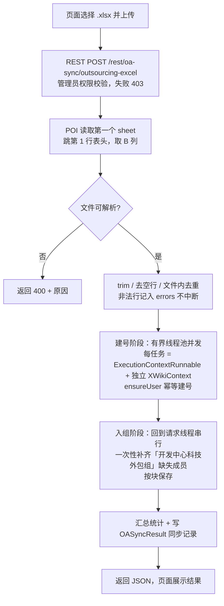

# 科技外包用户 Excel 初次全量导入设计

> 2026-09-15 | 状态：设计已确认，待评审

## 1. 背景与需求

科技外包用户的**增量**同步已通过监听知脉(DOAP) MQ 实现（topic `TOPIC_DOAP_USER`，见 `docs/doap-mq-user-sync.md`）。但增量链路只能覆盖"上线之后发生变化"的用户，**上线那一刻已存在的外包人员没有任何消息会推送**，因此需要一次**初次全量导入**把存量人员补齐。

数据由业务方以 Excel 形式提供，需求要点：

1. 上传一个 Excel，其中 `staff_id` 就是 XWiki 用户名，也是登录账号（口令由 OA SSO 负责，导入不设密码）
2. 归属的权限组**与 MQ 的实现完全一致** —— 即全部加入唯一固定组「开发中心科技外包组」
3. 只做**增量补齐**：Excel 之外的人一律不动（不禁用、不移出组），生命周期仍由 MQ 负责
4. 页面可上传、可重复执行，且幂等
5. 同步执行（不做异步 Job），但内部允许并发以压缩耗时
6. 只导数据，不引入新的组方案、不引入反向对齐

### 已确认的输入格式

| 项 | 结论 |
|---|---|
| 文件格式 | `.xlsx` |
| sheet | 只有一个 sheet |
| 表头 | 第 1 行 |
| 工号列 | **B 列**（0-based index 1） |
| 其余列 | 全部忽略 |
| 行数 | 约 700–800 行 |
| 前导零 | **没有**，工号不存在前导零丢失问题 |

## 2. 与 MQ 增量链路的一致性（核心约束）

这是本设计的**第一原则**：Excel 导入必须与 MQ 增量产生**完全相同的结果状态**，否则两条链路会互相打架。

MQ 侧的权威行为定义在
`xwiki-platform-core/xwiki-platform-oa-sync/xwiki-platform-oa-sync-default/src/main/java/org/xwiki/oa/sync/internal/mq/DoapUserSynchronizer.java`：

| # | MQ 规则 | Excel 导入如何对齐 |
|---|---|---|
| 1 | `type=outsourcing` 才处理 | 恒定按 outsourcing 语义处理 |
| 2 | `staffId` = XWiki 用户名 | B 列即 staffId |
| 3 | 用户不存在 → `wiki.createUser(username, 空Map)` | **调用同一个方法** |
| 4 | 加入唯一固定组 `DoapMqConstants.OUTSOURCING_GROUP_NAME` | **引用同一个常量**，不复制字符串 |
| 5 | `isDeleted=true` 或 `status=dismission` → 禁用；否则保持原状 | Excel 无状态列，**导入不做任何禁用**（只建号 + 入组） |

**实现手段**：不复制任何逻辑，而是把 `DoapUserSynchronizer` 内部拆成可复用的方法，Excel 导入调用同一份代码。这样「与 MQ 一致」是结构上保证的，而不是靠人工同步两份代码。

> 明确排除的方案：复用文件链路的 `UserGroupSynchronizer`。它按机构分组（组名 `orgCode_1`、标题 `orgName_外包组`，见 `OutsourcingFileParser` 第 110 行），与已确认的"单一固定组"直接冲突。

### 2.1 实施中发现并修复的 MQ 现存 bug（**会改变线上行为，需知悉**）

实施 Task 4 时发现 MQ 侧原有的入组实现有一个严重 bug，必须一并修复：

```java
BaseObject memberObject = groupDoc.getXObject(groupClassRef);   // ← 返回该类的“第一个”对象
if (memberObject == null) {
    memberObject = groupDoc.newXObject(groupClassRef, context);
}
memberObject.setStringValue("member", userFullName);
```

`XWikiDocument.getXObject(DocumentReference)` 的语义是「返回该类的**第一个**非空对象」
（`xwiki-platform-oldcore/.../doc/XWikiDocument.java` L3132-3146：遍历取到第一个非 null 就 `break`）。
因此当组里已有成员、而新用户**不是**成员时，这段代码会**覆盖第一个已有成员**而不是新增对象。

**净效果：「开发中心科技外包组」永远只能容纳一个外包用户**，每来一个新用户就把第一个人挤掉。
现有单测只加过单个用户，所以从未暴露。已用回归用例实证：

```
修复前 keepsAllMembersWhenAddingSeveralUsers:
  expected: <[XWiki.10086, XWiki.10087, XWiki.10088]> but was: <[XWiki.10088]>
```

**这是对 §2 "对外行为逐字不变"原则的一处有意例外**：修复后的行为才是原本就该有的行为。
不修的话，Excel 全量导入 ~800 人只会剩下最后一个人，功能直接失效。

**连带影响**：线上那个组当前很可能只保留了最后一个外包用户（其余成员的成员对象被陆续覆盖）。
本次 Excel 初次全量导入会把所有人重新加回来，因此**不需要额外的一次性数据修复动作**——
这也是"先做全量导入再做增量"这个顺序的额外收益。

**修复方式**：为每个待加成员 `newXObject` 创建**新**对象，绝不复用已有对象；
并按 200 个成员一块分批保存（避免 800 个 XObject 挤在一个 revision 里）。

> 顺带核对：`internal/sync/UserGroupSynchronizer`（文件链路的行员/外包同步）里有同名的
> `addMemberIfMissing`，但它**已经是**无条件 `newXObject`（L140），不存在同类 bug，无需改动。

## 3. 模块结构与变更清单

`xwiki-platform-oa-sync-api` **不需要改动**：`DoapUserSynchronizer` 位于 default 模块内部，是同模块组件，可直接注入，且 MQ 的对外契约（`DoapUserMessageHandler` / `DoapMqConstants`）不变。

### 新增（`xwiki-platform-oa-sync-default`）

| 文件 | 职责 |
|---|---|
| `internal/excel/OutsourcingExcelParser` | POI 解析 Excel → `usernames` + 逐行 `errors` |
| `internal/excel/OutsourcingExcelImportService` | 编排：解析 → 并发建号 → 串行入组 → 统计 |
| `internal/excel/ExcelImportResult` | 导入统计承载（created / existed / joinedGroup / alreadyMember / failed / errors） |

### 修改（`xwiki-platform-oa-sync-default`）

| 文件 | 改动 |
|---|---|
| `internal/mq/DoapUserSynchronizer` | 抽出 `ensureUser(...)`、`addToOutsourcingGroup(...)`；新增批量入口 `ensureUsers(...)`。**MQ 的 `sync(message, context)` 对外行为逐字不变** |
| `src/main/resources/META-INF/components.txt` | 注册新增组件 |
| `pom.xml` | 增加 `poi-ooxml` 依赖 |

### 修改（`xwiki-platform-oa-sync-ui`）

| 文件 | 改动 |
|---|---|
| `src/main/resources/OASync/WebHome.xml` | 增加「上传 Excel 导入外包用户」一节 |

## 4. 核心流程



**关键设计点**：把「建号」与「入组」拆成两个阶段，而不是像 MQ 那样每人走一遍 `建号+入组`。原因有两个：

1. **并发安全**：组文档是单点，并发写会互相覆盖，入组必须串行。
2. **性能**：现有 `addMemberIfMissing` 每加一个人就 `GroupManager.getMembers()` 全量加载 + `saveDocument()` 保存整份组文档，800 人退化成 O(n²)（约 800 次含递增成员数的文档读写）。批量入组改为「一次加载 → 补齐缺失 → 分块保存」，最终状态与逐条完全等价。

## 5. 并发模型

### 5.1 技术依据（已在本仓库验证）

平台不允许随意起线程池直接操作数据库，因为 Hibernate session 是线程绑定的。本仓库的验证结论：

| 事实 | 证据 |
|---|---|
| ExecutionContext 是线程私有的 | `xwiki-commons-core/.../context/internal/DefaultExecution.java` L45：`ThreadLocal<Stack<ExecutionContext>>` |
| Hibernate session 挂在 ExecutionContext 上 | `xwiki-platform-oldcore/.../store/XWikiHibernateBaseStore.java` L204-207 委托 `HibernateStore.getCurrentSession()`；后者 `.../internal/store/hibernate/HibernateStore.java` L642-647 从 `ExecutionContext.getProperty("hibsession")` 取 |
| 平台已有"每任务独立上下文"包装器 | `xwiki-commons-core/.../context/concurrent/ExecutionContextRunnable.java`，已被 `SchedulerPlugin`、notifications 等模块使用 |

**推论**：只要每个并发任务包裹在 `ExecutionContextRunnable` 中，就天然获得独立的 ExecutionContext 与独立 Hibernate session，互不干扰。MQ 消费侧的多线程（`xwiki.doap-mq.consume-thread-max` 默认 8）已经在生产验证了这个模式。

### 5.2 阶段划分与线程策略

| 阶段 | 并发 | 说明 |
|---|---|---|
| POI 解析 | 串行 | 800 行毫秒级，并发无收益 |
| 建号 `createUser` | **并发** | 每个任务包 `ExecutionContextRunnable`；任务内 `Provider<XWikiContext>.get()` 取本线程 context；`finally` 调 `store.cleanUp(context)` 结束事务、释放连接 |
| 入组 | **串行** | 在请求线程内完成，见 5.3 |

### 5.3 入组的分块串行写

1. 确保组文档存在（复用 `DoapUserSynchronizer` 的 `ensureGroup` 逻辑）
2. 取当前组成员集合
3. 计算缺失成员
4. 每 **200** 个缺失成员为一块：加载组文档 → 追加这一块的 XWikiGroups 对象 → 保存一次

分块而非单次全量保存，是为了避免 800 个 XObject 挤在一个 revision 里的内存与序列化开销；200 是保守默认值。**不加任何并发**。

### 5.4 线程池参数

| 参数 | 默认 | 说明 |
|---|---|---|
| `xwiki.oa-sync.excel.threads` | 4（上限 8） | 瓶颈是 DB 写与文档保存；4 线程已能大幅压缩 800 次建号。再高容易在 `xwikidoc` / `xwikiobjects` 上产生锁竞争，收益递减 |
| 线程命名 | `oa-excel-import-N` | 便于日志排查 |
| 整体超时 | 10 分钟 | 防止请求线程永久挂住 |
| 关闭 | 任务结束后关闭池 | 组件实现 `Disposable`，容器关闭时兜底释放 |

### 5.5 必须知晓的副作用：新建用户的文档作者

`ExecutionContextRunnable` 创建的是**干净上下文**，不会继承当前登录用户。而 `XWiki.createUser` 用 `context.getUserReference()` 决定文档作者（`XWiki.java` L4218-4223）：

- 有登录用户 → 作者 = 当前用户
- 无登录用户 → 作者 = **该用户自己的用户页**

因此 Excel 导入创建的用户文档，作者会是该用户自己 —— **这与 MQ 建号完全一致**。若要求用户历史里显示"是哪个管理员导入的"，就必须把请求线程的登录用户注入子上下文，那会与 MQ 产生差异。

**决定：与 MQ 保持一致（作者=自己）**，操作人只记入日志。

## 6. 接口设计

### 6.1 REST 端点

```
POST /rest/oa-sync/outsourcing-excel
Content-Type: application/octet-stream
Body: .xlsx 原始字节
```

选择**原始字节流**而非 `multipart/form-data` 的理由：`MultiPartFeature` 虽然随 `jersey-media-multipart-3.1.11.jar` 提供且带 `AutoDiscoverable` SPI，但本仓库源码中**没有任何显式注册**，存在环境差异风险；原始流用 JAX-RS 的 `InputStream` 参数即可，零额外依赖、零配置风险。

**权限**：必须做管理员权限校验。`XWiki.createUser` 自身**不做任何权限检查**（`XWiki.java` L4190-4223 只读 `context.getUserReference()` 记作者），所以端点若不校验，等于对外开放了一个任意建号接口。非管理员返回 403。

请求样例：

```javascript
fetch('$request.contextPath/rest/oa-sync/outsourcing-excel', {
  method: 'POST',
  headers: { 'Content-Type': 'application/octet-stream' },
  body: file                       // <input type="file"> 的 File 对象
})
```

成功响应：

```json
{
  "status": "SUCCESS",
  "total": 782,
  "created": 640,
  "existed": 142,
  "joinedGroup": 380,
  "alreadyMember": 402,
  "failed": 0,
  "errors": []
}
```

`status` 取值沿用 `OASyncResult.Status`：`SUCCESS` / `PARTIAL_FAILURE`（有行级或用户级失败）/ `FAILURE`（文件级失败，HTTP 400）。

### 6.2 页面 UI

在 `OASync/WebHome.xml` 的「手动触发」之后新增一节：

- `<input type="file" accept=".xlsx,.xls">` + 「上传并导入」按钮
- 上传期间禁用按钮并提示"导入中，请勿关闭页面"
- 完成后用 `XWiki.widgets.Notification` 展示 `created / existed / alreadyMember / failed`，失败明细折叠展示
- 该页面已设置 `<hidden>true</hidden>`，仅管理员通过直链访问

## 7. 幂等与错误处理

### 7.1 幂等

| 操作 | 幂等保证 |
|---|---|
| 建号 | `wiki.getDocument(...).isNew()` 判断，已存在则跳过（`createUser` 本身对已存在用户返回 -3） |
| 入组 | 先用 `GroupManager.getMembers(groupRef, false)` 求差集，已是成员的不重复添加 |
| 整体重跑 | 第二次执行 `created=0`、`joinedGroup=0`，可安全反复执行 |

### 7.2 错误处理

| 层级 | 处理 |
|---|---|
| 文件级（非法 xlsx、无 sheet、IO 失败） | HTTP 400 + 原因，同时写一条 `FAILURE` 同步记录（便于事后追溯失败的上传） |
| 行级（B 列为空、单元格是公式或日期格式、staff_id 超长/含非法字符） | 收集进 `errors`（带行号与原因），**不中断整体**，最终状态 `PARTIAL_FAILURE` |
| 用户级（`createUser` 抛 `XWikiException`） | 该用户计入 `failed`，其余继续（与 `DefaultOASyncService` 的逐条隔离一致） |
| 入组失败 | 整体返回 `PARTIAL_FAILURE`；已建号不回收（重跑即可补齐入组） |

**部分成功的语义**：建号成功但入组失败时，用户存在但不在组内。由于重跑幂等，再次导入即可修复，不需要事务回滚。

**零数据行不算文件级失败**：解析层对以下两种形态都返回空工号列表、不产生 error，
导入结果为 `SUCCESS` 且 `total=0`：

| 形态 | 结果 |
|---|---|
| (a) 只有表头、没有任何数据行 | `SUCCESS`，`total=0` |
| (b) 工作表本身零行（连表头都没有） | `SUCCESS`，`total=0` |

理由：这属于"合法但没数据"的文件形态，不是错误文件；把它当 400 会破坏合法的"只导表头"场景。
操作者在页面提示里能直接看到"总数=0"，足以识别"传错文件 / 传错月份"。

> 已知取舍：`total=0` 是唯一的信号，没有额外的 warning。若日后运维反馈"0 行导入不易察觉"，
> 可在解析层补一条 warning（会进同步记录的 errorLog），属低成本后续项。

### 7.3 解析细节

- 用 POI `WorkbookFactory.create(InputStream)` 兼容 `.xlsx` / `.xls`
- **按单元格类型取值，不能一律用 `DataFormatter`**。`DataFormatter` 返回的是"按单元格显示格式渲染的字符串"，
  会把语义完全不同的单元格伪装成"看起来合法"的工号并被静默接受。实测后果：
  - 数字型 + `#,##0` 格式 → `"10,086"`（逗号不在非法字符集里）→ 静默建出错误用户
  - 日期格式 → `"2026-01-02"` → 静默建出错误用户
  - 公式单元格 → 返回公式文本 → 静默建出错误用户

  因此取值规则为：`FORMULA` → 记错误；`DateUtil.isCellDateFormatted` 为真 → 记错误；
  `NUMERIC` → 用 `NumberToTextConverter.toText(double)` 取与显示格式无关的原始数值文本；
  其余类型才交给 `DataFormatter`。

  > **数值型必须做精度回读校验**：`NumberToTextConverter` 刻意模仿 Excel，其 javadoc 明确
  > `No more than 15 significant figures are output (java does 18)`。实测
  > `1234567890123456` → `"1234567890123460"`（**错了 4**），16 位有效数字就会丢精度，
  > 而不是 2^53。若不校验，会静默取到被四舍五入的**错误工号**并建号成功。
  > 因此取文本后用 `Double.parseDouble(text) != value` 回读比对，不等即记错误并提示把该列设为文本格式。
- 工号两侧用 `strip()` 清理（`trim()` 只去 ASCII ≤U+0020，去不掉全角空格 U+3000）；
  非法字符集并入 `\p{Zs}`，拦住 `strip()` 去不掉的不换行空格 U+00A0 等
- `WorkbookFactory.create` 对用户可上传的坏文件抛的是 **unchecked** 异常
  （空文件 → `EmptyFileException`，非 Office 文件 → `NotOfficeXmlFileException`），
  必须统一转成 `IOException`，否则上游的"文件级失败"分支抓不到，只会变成 HTTP 500 且不落失败记录
- 表头行仅跳过，不校验列名（B 列位置固定）

  > **已知后果（有意取舍）**：第 1 行被**无条件**当作表头丢弃。因此如果上传的文件没有表头
  > （或表头被删掉），**第一个人的工号会被当作表头静默丢掉**，且不会有任何报错或告警。
  > 这是"位置固定、不校验列名"的必然代价，且列错位同样不可察。
  > 之所以不加校验：真实 Excel 的 B1 表头文字**尚未由需求方确认**，
  > 用 `B1 != "staff_id"` 之类硬编码判断会在表头文字不同的情况下每次导入都误报。
  > 待拿到 B1 的确切文字后，可补一条"表头不匹配则记 warning"的低成本校验。
  > 在此之前，**每次初次全量导入后必须核对组内成员数是否等于 Excel 去重行数**
  > （见测试计划的手工验证项），这是当前唯一的兜底手段。

- 文件内出现重复 staff_id 时**去重并记一条 warning**（不作为错误）
- 空行静默跳过；行内有内容但 B 列为空 → 记错误
- 读取结束后按行号排序输出 `errors`，便于人工核对

## 8. 同步记录

复用现有 `OASyncResult` + `SyncRecordStore`，让导入历史出现在 `OASync.WebHome` 的「最近同步记录」表格中：

- `type` = `outsourcing-excel`
- `triggerType` = `MANUAL`
- `syncDate` = 导入当天
- `totalCount` / `successCount` / `failCount` = 解析行数 / 成功建号或已在册数 / 失败数
- `errorLog` = 行级 + 用户级错误明细

**已知局限**：`OASyncResult` 没有操作人字段，无法记录"谁导入的"。操作人写入日志（`LOGGER.info`）。若后续审计要求入库，需给记录类加字段，属额外范围。

`SyncRecordStore.cleanup(type, context)` 的 XWQL 带 `syncType = :type` 条件，清理范围**仅限同一 type**，因此 `outsourcing-excel` 的记录不会挤掉行员/外包的记录，各自独立保留最近 10 条（`SyncRecordStore.java` L111-129 已确认）。

## 9. 配置项

追加到 `xwiki-platform-tools/xwiki-platform-tool-configuration-resources/src/main/resources/xwiki.cfg.vm`（沿用现有 `xwiki.doap-mq.*` 的写法，默认注释关闭）：

```properties
#-# Excel 全量导入外包用户时的建号并发线程数（默认 4，建议不超过 8）
# xwiki.oa-sync.excel.threads=4
```

不给导入端点加启用开关：它按需调用且做了管理员权限校验，加开关只增加运维负担。

## 10. 测试计划

### 单元测试（`xwiki-platform-oa-sync-default`）

| 测试类 | 覆盖点 |
|---|---|
| `OutsourcingExcelParserTest`（新增） | 正常解析；跳过表头行；B 列为空；文件内重复 staff_id 去重；数字型单元格不丢精度/不转科学计数法；空 sheet；单 sheet 多空行；`.xls` 与 `.xlsx` |
| `DoapUserSynchronizerTest`（增补回归） | MQ 的 `sync()` 行为逐条不变（现有用例须全绿）；批量入组只保存一次；批量入组幂等；批量路径与逐条路径最终状态等价 |
| `OutsourcingExcelImportServiceTest`（新增） | 统计口径（created/existed/joinedGroup/alreadyMember/failed）；单用户失败隔离；文件级失败抛出正确异常；并发建号无重复创建 |

### 接口测试

- 非管理员调用端点 → 403
- 非法文件 → 400

### 手工验证（实现后必须做）

1. 用真实 Excel（约 780 行）在本地实例执行一次，记录**总耗时**
2. 校验抽样用户：存在、可登录（SSO）、在「开发中心科技外包组」内
3. 立刻重跑一次，确认 `created=0`、`joinedGroup=0`（幂等）
4. 校验组文档成员总数 = Excel 去重后行数（在有既有成员的场景下验证差集正确）

## 11. 风险与待验证项

| # | 风险 | 处置 |
|---|---|---|
| 1 | ~~`poi-ooxml` 依赖 scope 冲突~~ **已解决**：确认 `poi-ooxml` 在源码内无任何提供方（oldcore 只打包 `poi`），`provided` 会运行期 `ClassNotFoundException`，故用 `compile`；`dependency:tree` 已验证 poi/poi-ooxml 同为 5.5.1、无 upper-bound 冲突 | 已按 `compile` 落地 |
| 2 | 4 线程并发建号在 `xwikidoc`/`xwikiobjects` 上的锁竞争，实测可能不如预期 | 保守默认 4；实测后可调，上限 8 |
| 3 | 800 次 `createUser` 含文档保存 + 事件通知，同步等待可能仍达分钟级 | 已确认接受同步执行；前端给明确"导入中"提示。若实测超 10 分钟（整体超时）再评估改异步 Job |
| 4 | 子上下文作者为自己导致用户历史不含导入人 | 已确认接受（与 MQ 一致），操作人记日志 |
| 5 | **上传体积无上限**：`WorkbookFactory.create(InputStream)` 是 DOM 式加载，整个文件进内存，内存占用随文件大小而非行数增长；超大文件可被用来打爆堆 | **已纳入实施计划，不是"以后再说"**：体积上限落在 **REST 端点这一层**（计划 Task 6 Step 5，显式验收项；解析器侧不该有、也无法知道上传大小）。超限按 §7.2 记 `FAILURE` 并返回 **400**（不是 500）。当前 800 行规模无影响，但端点是管理员可反复调用的入口，闸门必须有 |

## 12. 非目标（YAGNI）

以下明确**不做**：

- 反向对齐（禁用/移出 Excel 之外的人）
- 按机构/部门分组（组方案唯一，就是「开发中心科技外包组」）
- 导入时设置启用/禁用状态（Excel 无状态列；禁用由 MQ 负责）
- 把 Excel 接入现有 `OASyncSource` / FTP / 定时 Job 链路
- 从 Excel 读取姓名、邮箱等资料字段（其余列一律忽略）
- 异步 Job + 进度条
